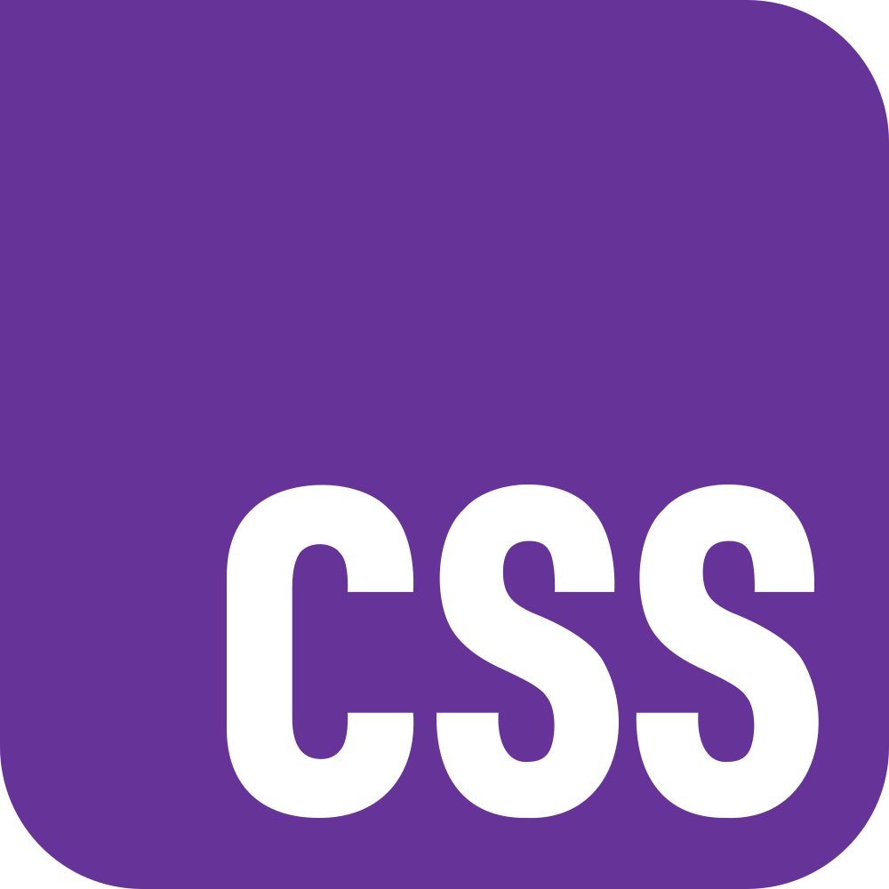
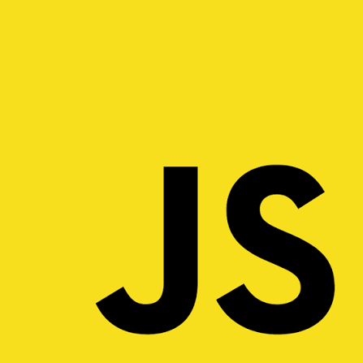
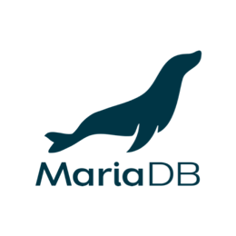

# Projeto Integrador ( Senac )

<strong style="font-size: 1.5em">Técnico em Informática para Internet:</strong>

O curso de Técnico em Informática para Internet ensina a desenvolver, implementar e manter aplicações e sistemas para a internet. Abrange programação, desenvolvimento web, bancos de dados, design de interfaces, redes, segurança da informação e gerenciamento de projetos. Durante o curso, o aluno aprende a criar sites e aplicações, desenvolver sistemas com integração a bancos de dados, construir interfaces responsivas, trabalhar com tecnologias de front-end e back-end e compreender os fundamentos da infraestrutura e segurança de aplicações web. Ao concluir o curso, o profissional estará preparado para atuar no desenvolvimento web, criação e manutenção de sistemas, administração de bancos de dados e suporte a aplicações e serviços para internet.

---

### Algumas tecnologias utilizadas:

    
    
    
    
    
    
    
    

---

### Participantes:

- Lucas Ferreira Silva
- Ially **! Complete e corrija seu nome em caso de erro !**
- Kennedy **! Complete e corrija seu nome em caso de erro !**
- Ione **! Complete e corrija seu nome em caso de erro !**
- Brayan **! Complete e corrija seu nome em caso de erro !**
- Vinícius **! Complete e corrija seu nome em caso de erro !**
- Gabriel **! Complete e corrija seu nome em caso de erro !**
- Agnelo **! Complete e corrija seu nome em caso de erro !**
- Lorena **! Complete e corrija seu nome em caso de erro !**
- Sérgio **! Complete e corrija seu nome em caso de erro !**

---

### Links Importantes:

- Protótipo no Figma:

  > [**Clique aqui para visualizar.**](https://www.figma.com/design/DTWL549RTgFl28tVrWxldS/Reposit%C3%B3rio-de-projetos-senac?node-id=0-1&t=EOhf0fnbrVIUw5NJ-1)

---

- Repositório no Github:

  > [**Clique aqui para visualizar.**](https://github.com/lucasdevsilva26/senac-projeto-pi.git)

---

Este é um projeto [Next.js](https://nextjs.org) project inicializado com [`create-next-app`](https://github.com/vercel/next.js/tree/canary/packages/create-next-app).
